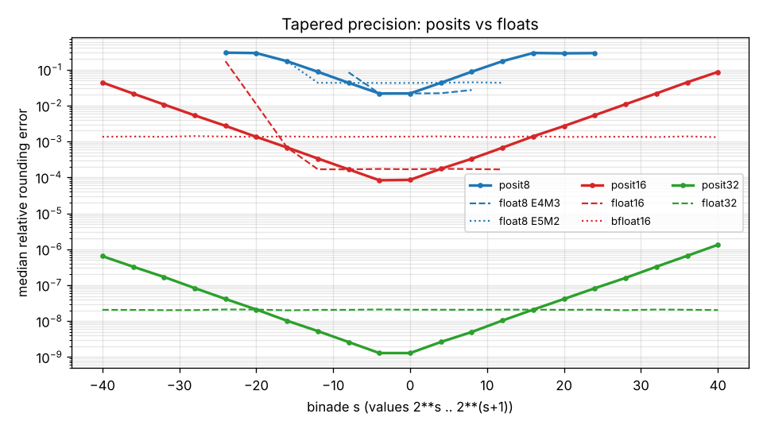

# positnp examples

A guided tour of **positnp**: NumPy-style arrays of [posit](https://posithub.org/docs/posit_standard-2.pdf)
numbers, computed either in software or by posit engines in the programmable logic of an AMD/Xilinx
Kria KV260 board. **You do not need the board**: the software backend (`PositSw`) produces the same
bits as the hardware, so every example below runs on any PC with Python and NumPy.

```bash
git clone https://github.com/TomekBarabasz/posit-numpy
cd posit-numpy/sw
pip install -e .            # only needs numpy; matplotlib is optional (one plot)
python3 examples/00_hello_posit.py
```

```python
import numpy as np, positnp as pn

x = pn.array(np.linspace(-2, 2, 5))       # posit<32,2>; pn.array(x, pn.P16) for posit16
y = x * x - x / 3 + 1                     # +, -, *, /: every operation rounded once
np.sum(y), np.dot(x, y)                   # exact in the quire, rounded once
A = pn.array(np.random.rand(64, 64))
A @ A, np.fft.fft(x), np.convolve(x, y)   # matmul, FFT, FIR - every dot product exact
```

## What is a posit, in two sentences

A posit spends a variable number of bits on the exponent (the *regime*): numbers near 1 get more
fraction bits than a float of the same width, very large and very small numbers get fewer, and the
range is far wider (posit16: 1e-17 .. 7e16 instead of float16's 6e-8 .. 65504). There is one zero, no
infinities, no NaN zoo - a single NaR (Not a Real) - and a *quire*: an exact accumulator for sums of
products, so dot products, matrix products and FIR outputs are rounded only once.



*(generated by `30_tapered_precision.py --plot`)*

## The examples

Every numbered example takes the same options:

| command | backend |
| --- | --- |
| `python3 examples/NN_name.py` | `PositSw`: software (NumPy), any PC |
| `python3 examples/NN_name.py --sim` | the real hardware driver on register-level models of the engines (no board) |
| `sudo python3 examples/NN_name.py --hw` | KV260: the application that is already loaded |
| `sudo python3 examples/NN_name.py --hw posit32_16_8_mem` | KV260: load this application first |

### Getting started (housekeeping)

| file | what you learn |
| --- | --- |
| [`00_hello_posit.py`](00_hello_posit.py) | installation check, first array, version, which backend runs |
| [`01_posit_formats.py`](01_posit_formats.py) | posit8 / 16 / 32 and any `PositConfig(n, es)`: bit fields, maxpos / minpos, NaR, saturation, tapered precision |
| [`02_board_and_features.py`](02_board_and_features.py) | the KV260 from Python (`pn.board`): find, load, describe applications; **detect what each engine can do** (quire, matmul, FIR, function tables, FFT core, device memory) and choose code paths from it |
| [`03_backends_and_stats.py`](03_backends_and_stats.py) | `pn.set_backend`, `pn.using`, flag counters (`pn.stats`: inexact / sat / nar / fallback), checking hardware results against software, format conversions |

### Basics

| file | what you learn |
| --- | --- |
| [`10_arithmetic.py`](10_arithmetic.py) | `+ - * /`, scalars, broadcasting, rounding, comparisons, sort, NaR |
| [`11_numpy_interop.py`](11_numpy_interop.py) | indexing, ufuncs, `np.where` / `concatenate` / ..., mixing with ndarrays, what raises `TypeError` |
| [`12_quire_reductions.py`](12_quire_reductions.py) | `np.sum`, `np.dot`, `np.mean`, `np.linalg.norm` through the quire; `pn.quire` as an exact `Fraction` |
| [`13_fma_sqrt_functions.py`](13_fma_sqrt_functions.py) | `pn.fma`, `pn.axpy`, `np.sqrt`, `np.exp` / `log` / `sin` / `tanh` / `pn.sigmoid` (correctly rounded tables for posit8 / 16) |

### Linear algebra and signal processing

| file | what you learn |
| --- | --- |
| [`20_gemv_gemm.py`](20_gemv_gemm.py) | `A @ x`, `A @ B`, batched matmul; every element correctly rounded; speed on the board |
| [`21_fir_filter.py`](21_fir_filter.py) | FIR low-pass with `np.convolve`, matched filter with `np.correlate`, SNR per format |
| [`22_fft.py`](22_fft.py) | `pn.fft.fft / ifft / rfft`, `PositComplex`, block / exact / hardware-core methods, accuracy vs `np.fft` |
| [`23_device_memory.py`](23_device_memory.py) | `x.to_device()`: chains of operations in the engine's memory without copies |

### Where posits beat floats

| file | the problem | result |
| --- | --- | --- |
| [`30_tapered_precision.py`](30_tapered_precision.py) | rounding error by magnitude, and on normally distributed data | posit16: 2x less error than float16 for values in [1/16, 16), 16x less than bfloat16; no overflow up to 7e16 |
| [`31_16bit_range.py`](31_16bit_range.py) | norm, signal energy, softmax in 16 bits | float16: `inf`, 5% error, `nan`; posit16 + quire: 9e-4, 2e-4, within 0.2% |
| [`32_iterative_refinement.py`](32_iterative_refinement.py) | solve `A x = b`, cond(A) = 1e5, 32-bit storage | float32: 1e-3; float32 + float64 residual: 6e-8; posit32 + quire residual: 3e-9 |
| [`33_reproducible_sums.py`](33_reproducible_sums.py) | the same sum of 100 000 terms in different orders (sequential, pairwise, 2-32 threads, shuffled) | float32: 14 different results from 18 orders; posit32 quire: always the same bits |
| [`formats.py`](formats.py) | Horner evaluation with cancellation, long sums | posit32: 1 more correct digit than float32 (Horner), 2 more (tree sum) |
| [`quire_dot.py`](quire_dot.py) | ill-conditioned dot products, cond up to 1e18 | float64 fails at cond ~1e16; posit32 + quire stays at half an ulp |

The accuracy sections of the other examples show the same pattern:

| example | posit | float |
| --- | --- | --- |
| `13`: exp / tanh / sigmoid / sin / log on [-6, 6), median rel. error | posit16: 6e-5 .. 1.2e-4 | float16: 1.2e-4 .. 1.7e-4 (both correctly rounded) |
| `20`: 48 x 48 matmul, worst element | posit32: 7e-9, posit16: 5e-4 | float32 (BLAS): 1e-3, float16 (float16 sums): 1.35 |
| `21`: 127-tap FIR, arithmetic SNR | posit32: 176 dB, posit16: 79 dB | float32: 145 dB, float16: 56 dB |
| `22`: FFT, N = 64 .. 4096, rel. error | posit32: 2e-9 .. 5e-9 | float32 `np.fft`: 3.5e-8 |

It is not a one-sided story, and the examples say so where it is not: posits lose precision far from 1
(posit16 is less precise than float16 above 256 and below 1/256), and near 1 posit8 has exactly the
precision of float8 E4M3 - its advantage there is range, not digits. Posits shine when the data is
scaled to "order 1" and when sums can go through the quire.

## Write your own experiment

[`template.py`](template.py) is a starting point: one function `compute(x)` written once, run on
posit32 / posit16 / posit8 / float32 / float16 side by side with the error table. Helpers in
[`_common.py`](_common.py): `rel_err`, `digits`, `table`, `round_minifloat` (bfloat16, float8 E4M3 / E5M2
and other small floats NumPy does not have), `simulated_engines`.

Ideas that would make good examples: posit training of a small network with quire-exact gradients,
Kalman filters or IIR filters in posit16, PDE stencils, image processing in posit8, linear solvers with
posit16 storage and quire refinement. Contributions are welcome.

## On the board

The KV260 setup (bitstreams, `xmutil`, u-dma-buf, sudoers) is described in [`sw/README.md`](../README.md)
and [`hw/top-modules/vec/README.md`](../../hw/top-modules/vec/README.md). With an application loaded,
`--hw` runs every example on the engines; the speed sections of `20`, `21`, `22` and `23` then compare
against NumPy float32 on the board's Cortex-A53 (e.g. matmul ~390 M MAC/s per engine, posit16 `exp`
332 M/s vs 23 M/s for `np.exp` in float32).

Tests: `python3 -m pytest tests/test_examples.py` runs every example.
